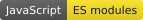
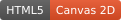
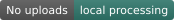
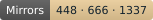
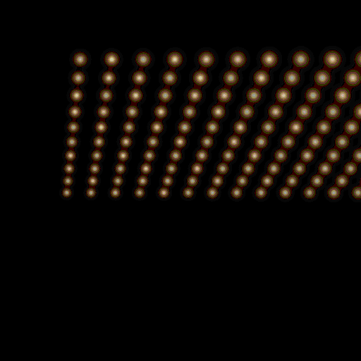

<div align="center">

# RAYMOSAIC ✨

[](https://github.com/dennishilk/raymosaic/actions/workflows/raymosaic-browser-qa.yml)
[](src/main.js)
[](index.html)
[](styles.css)
[](SECURITY.md)
[](#three-mirror-modes)
[](LICENSE)

### Draw with Light.

**One light. 1337 mirrors. A message made of reflections.**

[**Try it in English ↗**](https://www.dennishilk.com/lab/raymosaic/) · [**Auf Deutsch ausprobieren ↗**](https://www.dennishilk.com/de/lab/raymosaic/)



</div>

Type a name, draw a little heart, or write someone a longer message. RAYMOSAIC aims hundreds of individual virtual mirrors so one point light forms your design on a wall. Move the lamp and the image breaks apart; realign the mirrors and it returns. Export those calculated reflections as a GIF to send someone a little light.

This is a geometrical-optics experiment by [Dennis Hilk / NEBU](https://www.dennishilk.com/), built with JavaScript and Canvas 2D. The creative input guides mirror orientation; a separate forward renderer calculates the light you actually see.


## Create, explore, keep

- **Text and drawing:** presets, a multiline composer, brush, eraser, undo, and separate automatic orientation correction for text and drawings.
- **Complete messages:** up to 400 Unicode graphemes, split at words, punctuation and line breaks into optical scenes. Previous, pause and next controls let you inspect each part.
- **Explore the instrument:** orbit and zoom, move the point light, reveal rays, select a mirror to inspect its normal, and toggle scene labels.
- **Local exports:** looping GIFs in square, portrait or landscape; projection-only or full-scene rendering; warm or cool light; optional signature; progress and cancellation.
- **Still images:** PNG captures the currently selected optical scene at 1600 × 900.
- **Keep your work:** local autosave, validated `.raymosaic` project files and compressed creation links.
- **Two languages:** English and German interface, educational dialog and export messages.

## Three mirror modes

| Configuration | Actual facets | Text per scene |
| --- | --- | --- |
| **448 mirrors · Classic** | 28 × 16 | Up to 13 graphemes |
| **666 mirrors · DOOM of Love ❤️** | 37 × 18 | Up to 15 graphemes |
| **1337 mirrors · OVERDRIVE 🚀** | 51 × 27 lattice, 40 empty corner positions | Up to 17 graphemes |

Every facet has its own position, surface normal, ID and forward reflection calculation. Higher counts provide more light samples; detailed images still depend on the available geometry. OVERDRIVE is a playful nod to **1337 / leet** culture. DOOM of Love is a playful Easter egg, with no affiliation with the DOOM franchise.

Long messages span multiple scenes rather than being cut off at the single-scene capacity. Each scene recalculates the mirror normals; transitions animate those orientations. OVERDRIVE gives the live renderer more time between frames while retaining all 1337 mirrors.

## The optical calculation

1. Sample the text or sketch into desired wall coordinates.
2. Solve an orientation for each facet using the light position, mirror center and assigned target.
3. Independently reflect rays from the mirror center and corners, then intersect them with the wall.
4. Draw light spots at those computed intersections, with an illustrative glow.

For the unit incident direction **i** (source → mirror) and unit surface normal **n**, the law of reflection is:

```text
r = i − 2(i · n)n
```

The normal bisects the directions needed to send light toward the target. For desired outgoing unit direction **o**, the inverse solver uses `n = normalize(o − i)`, subject to its tilt limit. The forward renderer receives geometry and the source, with no access to the input text, drawing mask or target texture.

Moving the source without recalculating changes the incident rays and distorts the motif. That visible cause and effect is also a useful way to explore the model. Read [Architecture and optical assumptions](docs/ARCHITECTURE.md) for the derivation and limitations.

## GIFs and PNGs

**Projection only (no instrument)** draws only actual reflected light against solid black. It uses a dedicated flat projection path, so no mirrors, lamp, wall frame or technical scene geometry can enter the image. Framing comes from the union of forward ray intersections across the entire message. A single scale and center keep the sequence steady, with margins for glow and the optional signature. Projection GIFs disable ordered dithering.

**Full scene** retains the source, individual mirrors and projection wall with its own perspective camera. It shows how the artwork is made. Both modes encode real rendered frames locally in a cancelable Web Worker. Changing an export setting discards the old preview and download, so the file always represents the selected settings. Settings are locked during generation.

The **Make a GIF gift** shortcut selects a compact, three-second projection loop for a short message. Longer messages automatically extend the animation so every segment appears. If a high-resolution sequence exceeds the memory budget, choose Messaging quality or shorten the message. Nothing is silently truncated.

PNG saves the current scene, including the physical instrument. For multipart text, its filename includes the scene index. It does not contain the whole animated message.

Native GIF sharing appears only when the browser supports file sharing. A download remains available; messaging apps can re-encode or display animations differently. MP4 and WebM are not built-in export formats.

## Privacy and sharing

No account, analytics, tracking script, external rendering service or background upload. Text, sketches, mirror settings and exported frames are processed on your device. The static site still serves the application assets in the usual way.

Three sharing actions serve different purposes:

| Action | What is shared |
| --- | --- |
| **Share RAYMOSAIC ❤️** | The public lab URL, without your private motif |
| **Share my creation** | A compact project in the URL fragment; recipients can recreate the motif |
| **GIF / project download** | A local file that you choose whether to send |

Project format **v1** stores the motif, drawing mask, current and last-aligned light positions, camera, appearance, mirror count, label/orientation preferences and mirror normals. Files are validated before import. Local saves use browser storage; clearing site data removes them, so download a project file for a durable backup.

Creation links deterministically regenerate orientations from compact state. Native gzip compression is used where supported, with an approximately 1850-character fragment limit. Larger projects should travel as files. A fragment is not uploaded to create the link, but anyone who receives the complete URL can see its contents. External share services open only after an explicit click. See [SECURITY.md](SECURITY.md).

## Try it locally

Requirements: **Python 3** or another static HTTP server, and a recent desktop browser. Running the app needs no npm install, build step, API key or backend.

```bash
git clone https://github.com/dennishilk/raymosaic.git
cd raymosaic
python3 -m http.server 8000
```

Open [localhost:8000](http://localhost:8000), or [the German interface](http://localhost:8000/?lang=de). Serve over HTTP so ES modules and the Worker load correctly. On NixOS, `nix develop` provides the optional development environment in [flake.nix](flake.nix).

The canonical source lives here. The website repository regenerates its static copy with `scripts/sync-raymosaic.sh`; application changes should start in this repository.

## Tests

The numerical and project suite has no third-party dependencies:

```bash
node --test tests/*.test.mjs
```

For browser QA, install the same runner as CI, then keep the local HTTP server running:

```bash
npm install --no-save playwright@1.56.0
npx playwright install --with-deps chromium firefox
node tests/browser-smoke.mjs
node tests/mission05-browser.mjs
node tests/mission06-browser.mjs
node tests/mission07-browser.mjs
node tests/mission08-browser.mjs
```

Decode the downloaded media independently with Pillow:

```bash
python3 -m pip install pillow
python3 tests/check-browser-exports.py
python3 tests/check-mission06-exports.py
python3 tests/check-mission07-exports.py
python3 tests/check-mission08-exports.py
```

The [actual GitHub Actions workflow](.github/workflows/raymosaic-browser-qa.yml) runs these checks and retains exported media as artifacts. Mission 08 adds the complete Chromium/Firefox matrix for both rendering modes, three aspect ratios and all three mirror counts, plus signatures, complete message sequences, cancellation, localized UI, PNG and sharing. Rendering regressions verify that projection mode emits only forward light sprites on black, with no apparatus paths or text.

See [Mission 08 validation](docs/MISSION-08.md) for observed results and the before/after comparison. Example screenshots and GIFs are genuine application output; the [original 20-second demonstration](examples/raymosaic-20s-demo.mp4) predates the current UI.

## Browser support and limits

Chromium and Firefox are exercised by the automated browser suite. Core rendering uses Canvas 2D, ES modules and Web Workers. Creation links additionally need native compression APIs; native sharing depends on browser and operating-system support. No Safari or physical iOS verification is claimed by these desktop tests. Dennis has tried the app on his Android phone; automated phone-sized viewports are a separate check.

This is an educational geometrical-optics model. It uses an ideal point light and perfect planar mirrors, finite facet footprints and stylized glow. It does not model diffraction, polarization, wavelength-dependent materials, inter-mirror occlusion, self-shadowing or global illumination. Emoji appearance depends on installed fonts. More mirrors and longer, higher-resolution GIFs cost additional CPU time and memory.

## Source and contributions

| File | Responsibility |
| --- | --- |
| `src/optics.mjs` | Vectors, reflection, inverse solver, forward plane intersections |
| `src/targets.js` | Creative input samples, used only to aim mirrors |
| `src/scene.js` | Perspective apparatus and flat forward-light rendering |
| `src/export-renderer.js` | Explicit GIF rendering modes and optical sequence frames |
| `src/export-framing.mjs` | Shared framing from actual forward hits |
| `src/gif-worker.js` | Local GIF89a encoding |
| `src/message-sequence.mjs` | Unicode segmentation and complete export timelines |
| `src/project-state.js` | Validated storage, files and compact creation links |
| `src/main.js`, `src/i18n.js` | Interaction and English/German interface |

Contributions, optical corrections and accessibility findings are welcome; see [CONTRIBUTING.md](CONTRIBUTING.md). RAYMOSAIC and its generated example media are by Dennis Hilk. The source is licensed under the verified [MIT License](LICENSE), © 2026 Dennis Hilk.
