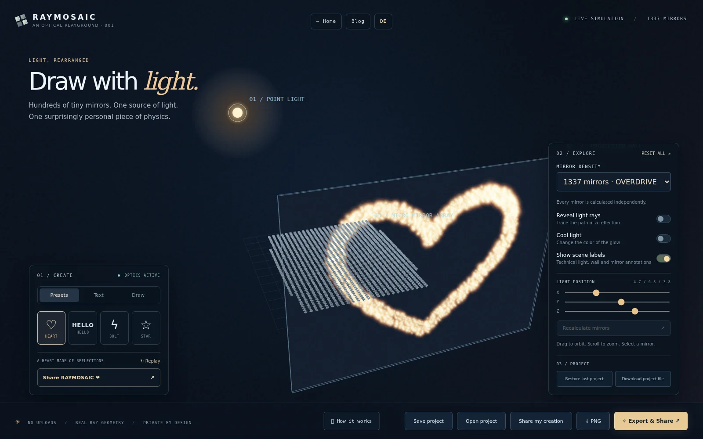
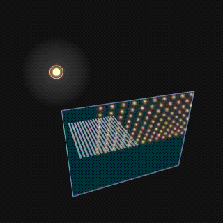

<div align="center">

# RAYMOSAIC ✨

### Draw pictures with reflected light — right in your browser.

**448 tiny mirrors. One light source. A message made entirely of reflections.**

A free, local-first optical playground by [Dennis Hilk](https://dennishilk.com). Turn a heart, word, or drawing into a glowing projection, move the lamp to break it, then realign the mirrors and export the moment as an animated GIF.

**[Quick start](#try-it-locally)** · **[How it works](#the-physics-not-a-hidden-texture)** · **[Examples](#see-it-in-action)** · **[Limitations](#what-this-prototype-does-not-simulate)**

</div>



> **Project stage: working engineering prototype.** Source code is available here, but there is **no public hosted demo yet**. The optical model and exported example GIFs have been tested; native Firefox/Chromium, accessibility and mobile release testing are still in progress. This is an interactive art/science experiment, not a laboratory-grade optics package.

## See it in action

<div align="center">



*An actual multi-frame GIF exported from RAYMOSAIC — not a static animation mockup.*

[20-second demo video](examples/raymosaic-20s-demo.mp4) · [Projection-only GIF](examples/raymosaic-nebu.gif) · [NEBU screenshot](examples/raymosaic-nebu.webp)

</div>

The original 3D composition is also available as the [heart screenshot](examples/raymosaic-heart.webp). All example imagery was generated from the application; no stock artwork or simulated screenshots were used.

## Try it locally

Requirements: **Python 3** (or any local static HTTP server) and a recent graphical browser. No npm install, account, API key, backend, or proprietary software is required.

```bash
# From the repository directory:
python3 -m http.server 8000
```

Open **http://localhost:8000**.

> For security and correct ES module loading, use a local HTTP server, not `file://`. Nothing is transmitted to RAYMOSAIC's servers — there is no RAYMOSAIC server.

On NixOS, you may instead enter the provided development environment with `nix develop` before running the command above.

### Your first minute

1. Watch the default heart form out of reflections.
2. Choose **Text**, enter a short word such as `NEBU`, and hit **Create**.
3. Turn on **Reveal light rays** and select a mirror to inspect it.
4. Move a **Light position** slider: the existing mirror orientations stay fixed, so the projection distorts.
5. Click **Recalculate mirrors** to solve for the new light position.
6. Click **Export & Share** to download a real looping GIF, or use **PNG** for a still image.

## What you can do

| Create | Investigate | Share |
| --- | --- | --- |
| Heart, HELLO, lightning bolt and star presets | Orbit/zoom the 3D instrument | Animated looping GIF |
| Custom text (best with short words) | Select a mirror and inspect its geometry | Projection-only or full-scene GIF |
| Freehand drawing with brush, eraser, undo and clear | Reveal incident and outgoing rays | Square, portrait or landscape |
| Warm or cool light | Move the source; manually recalculate the array | PNG snapshots, progress and cancellation |

Everything is calculated and encoded locally. The browser offers native file sharing **only where the Web Share API supports it**; downloading always remains the fallback.

## The physics, not a hidden texture

The target image is sampled into discrete points. An **inverse solver** computes a suitable orientation for each mirror; it is then deliberately kept separate from the **forward projection**. The forward renderer sees mirror geometry and the lamp — **not the original drawing or text**.

For an incoming unit ray direction **i** (light → mirror) and unit mirror normal **n**, the outgoing direction is:

\[
\mathbf{r}=\mathbf{i}-2(\mathbf{i}\cdot\mathbf{n})\mathbf{n}
\]

To aim at a desired wall point, let **o** be the outgoing unit direction (mirror → target). The ideal normal used by the solver is:

\[
\mathbf{n}=\frac{\mathbf{o}-\mathbf{i}}{\lVert\mathbf{o}-\mathbf{i}\rVert}
\]

Each mirror is represented by a finite square. The forward model reflects rays from its center and corners, computes intersections with the projection plane, and draws a stylized spot from those intersections. If the source moves without recalculation, the projected light moves too. That cause-and-effect relationship is the point of the experiment.

For code and validation details, see [Architecture and optical assumptions](docs/ARCHITECTURE.md).

## What this prototype does *not* simulate

RAYMOSAIC uses ideal point illumination, perfect planar mirror reflections, sampled facet footprints and stylized smooth glow. It **does not** currently model diffraction, polarization, wavelength dispersion, inter-mirror occlusion, global illumination or self-shadowing. Mirror positions and tilt constraints are finite, so small detailed drawings cannot be reproduced perfectly. The scene is rendered using a lightweight **software perspective renderer on Canvas 2D** — not Three.js or WebGL.

This is a **geometrical-optics educational model**, not physical photometry. We value clear explanations over pretending to be more precise than we are.

## Source layout

```text
raymosaic/
├── index.html              # Browser interface
├── styles.css              # Responsive visual design
├── src/
│   ├── optics.mjs          # Pure vectors, reflection, inverse solver, plane intersections
│   ├── targets.js          # Presets, text and drawing target samples
│   ├── scene.js            # Canvas-perspective scene and forward projection
│   ├── main.js             # UI, animation, export and sharing
│   └── gif-worker.js       # GIF89a encoder in a Web Worker
├── tests/
│   ├── optics.test.mjs     # Numerical optics regression tests
│   └── validate-exports.py # Independent GIF/PNG checks (Pillow)
├── examples/               # Real application screenshots, GIFs and video
├── docs/                   # Design notes and unpublished launch drafts
└── flake.nix               # Optional Nix development shell
```

Run the dependency-free numerical suite with:

```bash
node --test tests/optics.test.mjs
```

The six current tests cover the reflection law, known normals, forward-only intersections, inverse/forward consistency, invalid geometry and a recognizable asymmetric projection. The sample GIFs were independently decoded and checked for 30 frames and changing images. The image-validation script needs Pillow (`python3 -m pip install pillow` in an appropriate environment) and can be run with `python3 tests/validate-exports.py`.

### Known gaps before a public hosted launch

- Verify native ES-module loading and exports in current Firefox **and** Chromium on Linux, rather than relying only on the earlier inlined browser harness.
- Revisit mobile gesture usability, keyboard/screen-reader controls, lower-end GPU/CPU performance and repeated export memory behavior.
- Improve palette selection for larger GIFs and consider WebM as an additional output. MP4 and WebM **are not built-in export options** today.
- Consider a physically richer shadowing/occlusion mode while keeping the existing optical model independently testable.

## Privacy and licensing

No accounts. No analytics. No background uploads. Your typed words, drawings and exported frames are processed in your browser, and files are only shared if **you** take an explicit sharing action. See [Security and privacy](SECURITY.md).

Released under the [MIT License](LICENSE) (© 2026 Dennis Hilk). Contributions are welcome; see [CONTRIBUTING.md](CONTRIBUTING.md). Example media was produced from this project.

---

<div align="center">

*Make light draw.* 🌈

**Created by Dennis Hilk / NEBU** · [dennishilk.com](https://dennishilk.com)

</div>